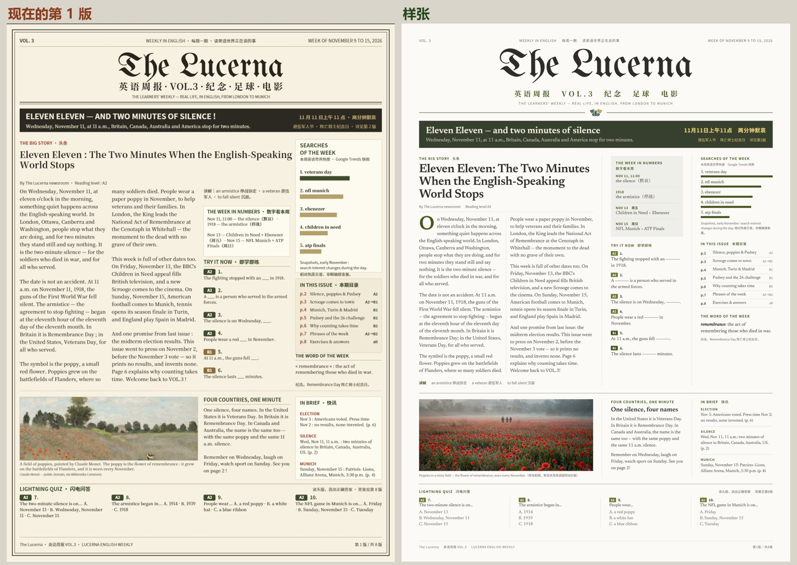
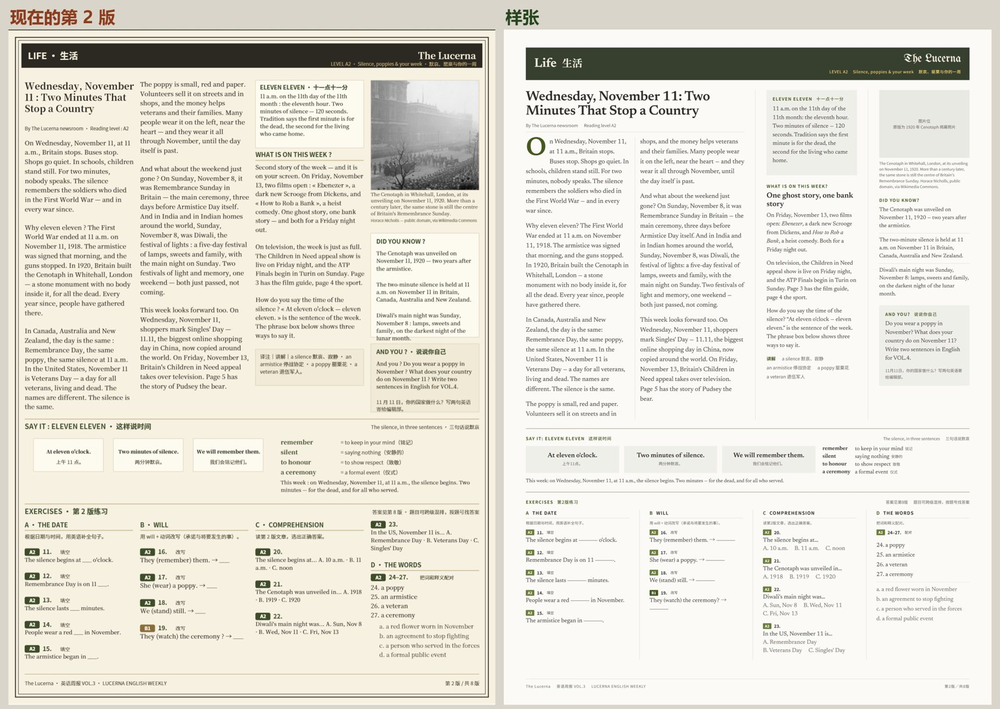
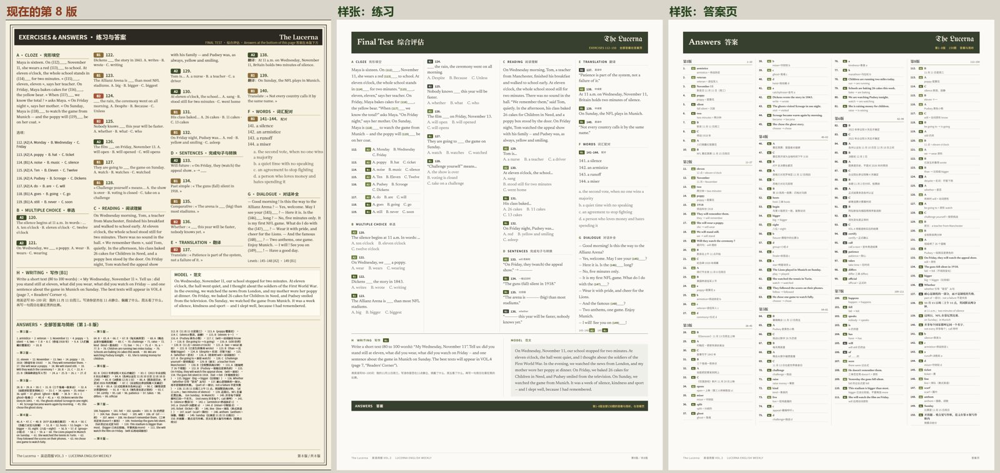

# PDF 内页版式规范（对齐网站周报页）

对应 issue：[#2](https://github.com/LucernaRead/weekly/issues/2)。网站周报页（LandingPage #4、#5，已上 dev）改成书衣绿底、近白新闻纸、哥特体刊头、橄榄绿强调。PDF 每一页在单期页上直接平铺展示，所以内页要用同一套颜色、字体和线条。

> 这个分支只放规范和样张，**不合并进 main**（本仓 lint 只允许 issues/ 和 covers/ 等目录）。样张以 2026-W46 英语版、简体中文讲解为例。

## 新旧对照

样张（版面实际尺寸 1462.5 × 2025 pt）：[第 1 版](samples/p1.pdf)　[第 2 版](samples/p2.pdf)　[第 8 版练习](samples/p8.pdf)　[答案页](samples/p9.pdf)。HTML 源文件和共用样式表 `base.css` 在 `samples/`，可直接在浏览器打开或用 Chrome 打印成 PDF。

## 颜色

| 名称 | 值 | 用在哪 |
|---|---|---|
| 新闻纸 | `#fbfaf6` | 每一页的纸色，替换现在的奶油色 |
| 墨 | `#302c28` | 刊头、标题、题号 |
| 正文 | `#3a3631` | 正文段落、练习题干 |
| 说明 | `#6f675d` | 中文讲解、图注、页眉页脚、选项 |
| 细线 | `#d8d2c4` | 栏间线、列表分隔线 |
| 书衣绿 | `#37402f` | 栏目条、导读条，替换现在的近黑底 |
| 橄榄绿 | `#46581f` | 栏目小字、首字下沉、刊头下和大块之间的分隔线 |
| 鹅黄 | `#f0d87c` | 书衣绿上的强调字，替换现在的金色 |
| 书衣绿上的字 | `#f4efe1` | 栏目条、导读条里的主标题 |
| 等级徽章 | A2 `#6b7d3a`、B1 `#46581f`、B2 `#37402f` | 白字，2pt 圆角，越难越深 |

## 字体

| 角色 | 字体 | 字重 |
|---|---|---|
| 刊头 | UnifrakturMaguntia | 400 |
| 西文标题、正文 | **Newsreader**（不再用思源宋体自带的拉丁字形） | 400 / 600，斜体用于本周词 |
| 中文刊别、中文标题 | Noto Serif SC | 400 / 700 |
| 栏目小字、讲解、页眉页脚 | Noto Sans SC | 500 / 700 |

### 字号阶梯（pt）

| 元素 | 字号 / 行高 | 备注 |
|---|---|---|
| 刊头 | 147 / 1.0 | 居中 |
| 刊别（英语周报 VOL.3 …） | 27 / 1.2 | Noto Serif SC 700，字距 0.32em，橄榄绿 |
| 导读条 / 栏目条标题 | 34.5–37.5 / 1.1 | Newsreader 600，书衣绿上 |
| 头条标题 | 40–45 / 1.06 | Newsreader 600，字距 −0.012em |
| 次级标题 | 22.5–24 / 1.15 | Newsreader 600 |
| 头条正文 | 18–19 / 1.5–1.55 | 两栏，左对齐 |
| 侧栏正文、练习题干 | 16.5–17.5 / 1.45 | |
| 栏目小字 | 12.75 | 大写，字距 0.12em，橄榄绿 |
| 讲解、图注、说明 | 11.25–13.5 / 1.6 | Noto Sans SC，说明色 |
| 答案 | ≥ 11.25 | 不再压小字号 |

## 线条与版面

- 去掉每页的双线外框。版心四边留白：上 54pt，左右 66pt，下 48pt。
- 只用两种线：栏间和列表 0.75pt 细线（`#d8d2c4`）；刊头下、大块之间 1.1–1.5pt 橄榄绿线。不再用双线。
- 刊头下一道橄榄绿线，三色蛾落在线中间（同网站封面）。
- 侧栏小框不加边框，用书衣绿 6% 的浅底（约 `#f0eee5`）区分。
- 栏目条（每版顶部的 LIFE 生活 这类）改成书衣绿底，主标题米白，副标题鹅黄。

## 排字写法

- 不用「·」做分隔，改用空隙：`THE BIG STORY · 头条` → `THE BIG STORY　头条`。
- 正文左对齐、右边参差（窄栏两端对齐又不断字，会撑出大空隙）。
- 中文里的数字不加空格：`第 1 版 / 共 8 版` → `第1版／共8版`，`11 月 11 日` → `11月11日`（答案和讲解里同样）。
- 头条第一段首字下沉，橄榄绿，约 4 行高。
- 填空线用 1.1pt 墨色下划线，约 3.2 个字宽，不再用连续下划线字符。
- 选择题的选项不在选项中间折行。
- **答案单独成页**：150 题答案和 A–H 练习放在一页必须压到 11.25pt 以下，所以答案另起一页，按版分组、每组标题至少带两条答案，每条写答案和一行中文简析。**PDF 因此从 8 页变成 9 页，请生产侧确认。**

## 待核对

- 期号不一致：index 的 `vol` 与 PDF 印的 VOL 有对不上的（见 #4）。
